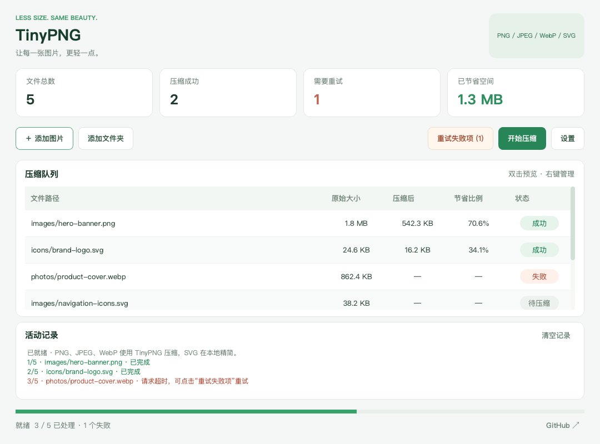

# 图片压缩软件
基于 TinyPNG 的批量图片压缩软件，支持 PNG、JPEG、WebP 和 SVG。


日常开发经常会用到[tinypng.org](https://tinypng.org/)图片批量压缩，TinyPNG平均压缩率能达到60%，肉眼能观察到的画质损失微乎其微，对页面加载提速及体验、节省用户流量、缩小程序包有很大帮助。


##### 下载：
- [Windows x64 安装包](https://github.com/zhili-wang/tinypng/releases/download/v1.1.0/TinyPNG-Windows-x64-1.1.0.exe)
- [Windows x64 免安装版](https://github.com/zhili-wang/tinypng/releases/download/v1.1.0/TinyPNG-Windows-x64-1.1.0.zip)
- [macOS 通用安装包（Intel / Apple Silicon）](https://github.com/zhili-wang/tinypng/releases/download/v1.1.0/TinyPNG-macOS-universal-1.1.0.dmg)
- [查看全部版本](https://github.com/zhili-wang/tinypng/releases)

### 新版功能

- **SVG 压缩**：支持选择文件、拖拽和递归扫描文件夹。SVG 在本地精简 XML 空白及注释，保留矢量路径、精度和文字；包含脚本、样式、嵌入 HTML 或 DTD 的文件保守保留原内容，结果不会比原文件更大。
- **重试失败项**：点击顶部按钮或按 `Ctrl+R`，一次重试所有失败文件。成功项与尚未开始的文件不参与这次重试；暂停后可点击“开始压缩”继续未完成任务。
- **新版界面**：统一的浅色界面、文件统计、状态标签、活动记录及进度条，设置窗口也已重新整理。

以下是新版界面的示例队列预览：



单独添加图片时保存到原路径；添加文件夹时，可在设置中选择覆盖原文件或保存到同级 `_tiny` 目录。保存采用临时文件提交，写入失败时保留原文件，方便重试。

### 配置
~~TinyPNG Key是免费的，为了安装后可以直接用，软件源码中已有2个Key，安装后会随机配置一个作为使用。每个Key每月免费压缩为500次，若不够可以自己多申请几个（申请很简单，填写邮箱和昵称，便会收到邮件，根据邮件中的链接进入创建key即可）；~~  
由于TinyPNG服务器在国外，国内访问较慢，如果你有国外代理可配置为其加速。  
**2021/08/11 新增免key模式，现在可以无需申请key。（原有的KEY模式同时保留）**

### Usage
 There are two ways to add files:

 1.Click the button at the top-left to choose one or more files or a folder;  
 2.For a more convenient and efficient option, it is recommended to drag and drop the objects directly into the table area of the window;  
 3.Use shortcut keys associated with the buttons, for example: press Ctrl+O to add an object, Ctrl+S to start a task;  
 4.Double-click any row in the table to preview the picture associated with that row in the system's image previewer;    
 5.You can delete rows either by right-clicking on any of them or by selecting the rows and pressing the Del key;    
  
 
 Remark: If the object you add is a folder, the software will automatically list all the image files contained within that folder recursively.

##### 免责声明
该仓库仅用于学习，如有商业用途，请购买官方的 pro 版：https://tinify.com/checkout/web-pro

This Repo is only for study.


### 开发与验证

使用 Qt 5.14+ 或 Qt 6 SDK 构建桌面程序：

```sh
mkdir -p build
cd build
qmake ../tinypng/VsTinypng.pro
make
```

`tests/regression.pro` 包含 SVG 渲染对比、格式过滤和重试筛选检查，需要 Qt SVG 模块。`tests/integration.pro` 验证真实任务调度、失败重试、暂停后继续、原文件保护和目录扫描。`tests/ui-preview.pro` 使用与程序共享的界面组件生成示例队列预览，检查两种窗口尺寸下的布局；它不执行网络压缩。

### 安装包构建

新版构建版本为 `1.1.0`。每次打包均使用新的构建目录，完整重新编译，不复用旧对象文件。GitHub Actions 中的 **Build installers** 可手动运行，生成 macOS 通用 DMG（Intel / Apple Silicon）和 Windows x64 安装 EXE、便携 ZIP；构建前会运行 SVG 渲染和失败项筛选检查。构建产物保存在 Actions 的 Artifacts 中；已发布的 `1.1.0` 安装包可从上方下载链接或 [Releases](https://github.com/zhili-wang/tinypng/releases/tag/v1.1.0) 获取。

本地 macOS 构建需要完整 Qt SDK（含 Qt SVG 模块）：

```sh
bash scripts/build-macos.sh /path/to/Qt/6.8.3/macos
```

Windows 构建需要 Qt MSVC x64 SDK、Visual Studio x64 Developer PowerShell 和 Inno Setup 6：

```powershell
./scripts/build-windows.ps1 -QtRoot C:/Qt/6.8.3/msvc2022_64
```

macOS 脚本采用本地临时签名；公开分发时仍需使用开发者证书签名和 Apple 公证。Windows 安装程序为当前用户安装，并附带 Qt 和 MSVC 运行库。
